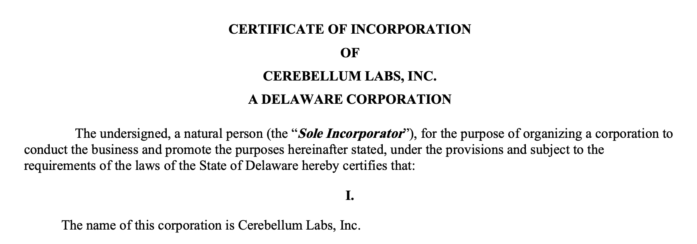

import Polaroids from "@/components/Polaroids.astro";
import Polaroid from "@/components/Polaroid.astro";
import hackathon from "@/assets/newsletters/issue-002/hackathon.jpg";
import whitney from "@/assets/newsletters/issue-002/whitney.jpg";
import artShow from "@/assets/newsletters/issue-002/art-show.jpg";
import pumpkins from "@/assets/newsletters/issue-002/pumpkins.jpg";
import train from "@/assets/newsletters/issue-002/train.jpg";
import tonysPizza from "@/assets/newsletters/issue-002/tonys-pizza.jpg";
import cafe from "@/assets/newsletters/issue-002/cafe.jpg";
import jeans from "@/assets/newsletters/issue-002/jeans.jpg";
import incorporation from "@/assets/newsletters/issue-002/incorporation.png";
import randallsIsland from "@/assets/newsletters/issue-002/randalls-island.jpg";

Hey everyone! We missed last week, so this newsletter covers the past two weeks. We went to a hackathon, spent a week in San Francisco, and some news on Cerebellum.

## General Updates on Cerebellum

- **We filed for incorporation.**
- **We pitched to Pear's partners.** They passed on us, but we learned a lot about the fundraising process.
- **We now have three design partners.** A legal AI company joined the two we already had.
- **We applied to a16z alpha.**

## In New York

On Thursday we went to the Reactor x Google DeepMind World Models Hackathon, and then spent the rest of the week seeing as much art as we could. Suhaas, Barkha, Brian and I went to the Whitney, and on Saturday I painted pumpkins in Sheep Meadow before heading to Brooklyn for a friend's art show, *My Bonds Taste like Cardamom and Blue*.

<Polaroids>
  <Polaroid src={hackathon} alt="Hackers at round tables in front of a big Google screen" caption="World Models Hackathon" />
  <Polaroid src={whitney} alt="A selfie of four friends in a gallery at the Whitney" caption="Suhaas, Barkha, Brian and me at the Whitney" focus="center 30%" />
  <Polaroid src={pumpkins} alt="Picnic blankets covered in paint, brushes and small painted pumpkins" caption="Pumpkin painting in Sheep Meadow" />
  <Polaroid src={artShow} alt="Colorful paintings on a white brick wall under a vaulted ceiling" caption="My Bonds Taste like Cardamom and Blue, my friend's art show" focus="center 40%" />
</Polaroids>

## In San Francisco

On Sunday we flew out to SF and spent the week catching up with friends and founders. We took the train down to Stanford to see Ady, worked out of a lot of coffee shops, and had pizza with Ashwin and friends at Tony's. We met up with founders at YC and Speedrun, and got a sense for the startup community in SF.

<Polaroids>
  <Polaroid src={train} alt="Suhaas looking out the window of a train" caption="On the train to Stanford" />
  <Polaroid src={tonysPizza} alt="A huge square pizza on a stand in a restaurant booth" caption="Pizza with Ashwin and friends at Tony's" />
  <Polaroid src={cafe} alt="Suhaas working on a laptop next to a latte" caption="Office for the week" />
</Polaroids>

## Back home

We flew back on Friday. On Sunday we went to a friend's birthday picnic on Randall's Island, and, in other news, Suhaas ripped his jeans.

<Polaroids>
  <Polaroid src={randallsIsland} alt="Friends gathered under big trees on a lawn by the water at golden hour" caption="Birthday picnic on Randall's Island" />
  <Polaroid src={jeans} alt="Suhaas holding up a pair of jeans in his room" caption="Suhaas ripping his jeans" focus="center 40%" />
</Polaroids>
